<a href="https://aliz-mejia.vercel.app">
  <picture>
    <source media="(prefers-color-scheme: dark)" srcset="assets/banner-oscuro.svg">
    
  </picture>
</a>

  <a href="https://aliz-mejia.vercel.app"><picture><source media="(prefers-color-scheme: dark)" srcset="assets/btn-portafolio-oscuro.webp"></picture></a>
  <a href="https://www.linkedin.com/in/alizz-doblezz"><picture><source media="(prefers-color-scheme: dark)" srcset="assets/btn-linkedin-oscuro.webp">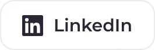</picture></a>
  <a href="mailto:dev.doblezz@gmail.com"><picture><source media="(prefers-color-scheme: dark)" srcset="assets/btn-correo-oscuro.webp">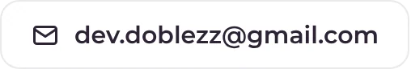</picture></a>
  <a href="https://buymeacoffee.com/alizz"><picture><source media="(prefers-color-scheme: dark)" srcset="assets/btn-cafe-oscuro.webp"></picture></a>

 

## ✦ Hola, soy Aliz

Desarrolladora de software de Bogotá, Colombia, trabajando freelance y en remoto. Construyo aplicaciones web de punta a punta: **tiendas, dashboards e integraciones con APIs** que hoy usan personas reales. Me importa tanto la base de datos como el logo.

  <picture>
    <source media="(prefers-color-scheme: dark)" srcset="assets/terminal-oscuro.svg">
    
  </picture>

- 💼 2 años y medio como desarrolladora en **Andrec Corporation** (Odoo 16, web y diseño). Hoy, **freelance**.
- 🎓 **Ingeniería de Sistemas** en la Universidad del Tolima · **Técnica en Programación de Software** (SENA).
- 🐮 Dato curioso: amo las vacas. Por eso MuMu tiene una vaquita que te dice qué hacer.

<b>🇬🇧 Read in English</b>

 

Software developer from Bogotá, Colombia, working freelance and remote. I build web apps end to end: **online stores, dashboards and API integrations** that real people use today. I care about the database as much as the logo.

- 💼 Two and a half years as a developer at **Andrec Corporation** (Odoo 16, web and design). Now **freelance**.
- 🎓 **Systems Engineering** at Universidad del Tolima · **Software Programming Technician** (SENA).
- 🐮 Fun fact: I love cows. That's why MuMu has a little cow that tells you what to do next.

 

## ✦ Proyecto principal

<a href="https://aliz-mejia.vercel.app/#/proyecto/mumu">
  <picture>
    <source media="(prefers-color-scheme: dark)" srcset="assets/proyecto-mumu-principal-oscuro.webp">
    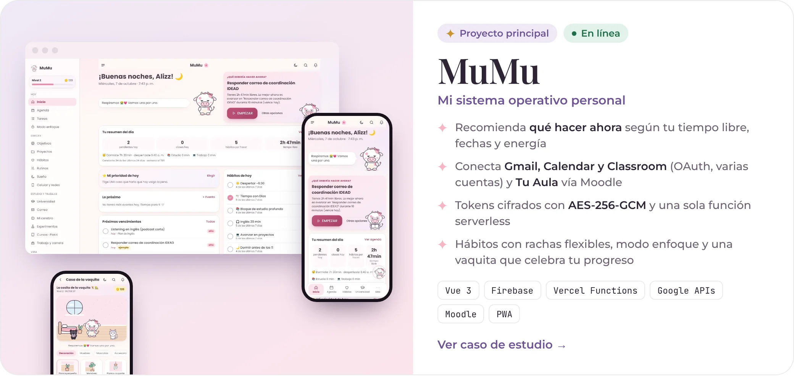
  </picture>
</a>

  <a href="https://aliz-mejia.vercel.app/#/proyecto/mumu"><b>Caso de estudio</b></a> &nbsp;·&nbsp;
  <a href="https://mu-mu-blond.vercel.app/"><b>Abrir MuMu ↗</b></a> &nbsp;·&nbsp;
  <a href="https://github.com/alizz3/MuMu"><b>Código</b></a>

 

## ✦ Más proyectos

  <a href="https://aliz-mejia.vercel.app/#/proyecto/el-taller-de-vane"><picture><source media="(prefers-color-scheme: dark)" srcset="assets/proyecto-el-taller-de-vane-oscuro.webp">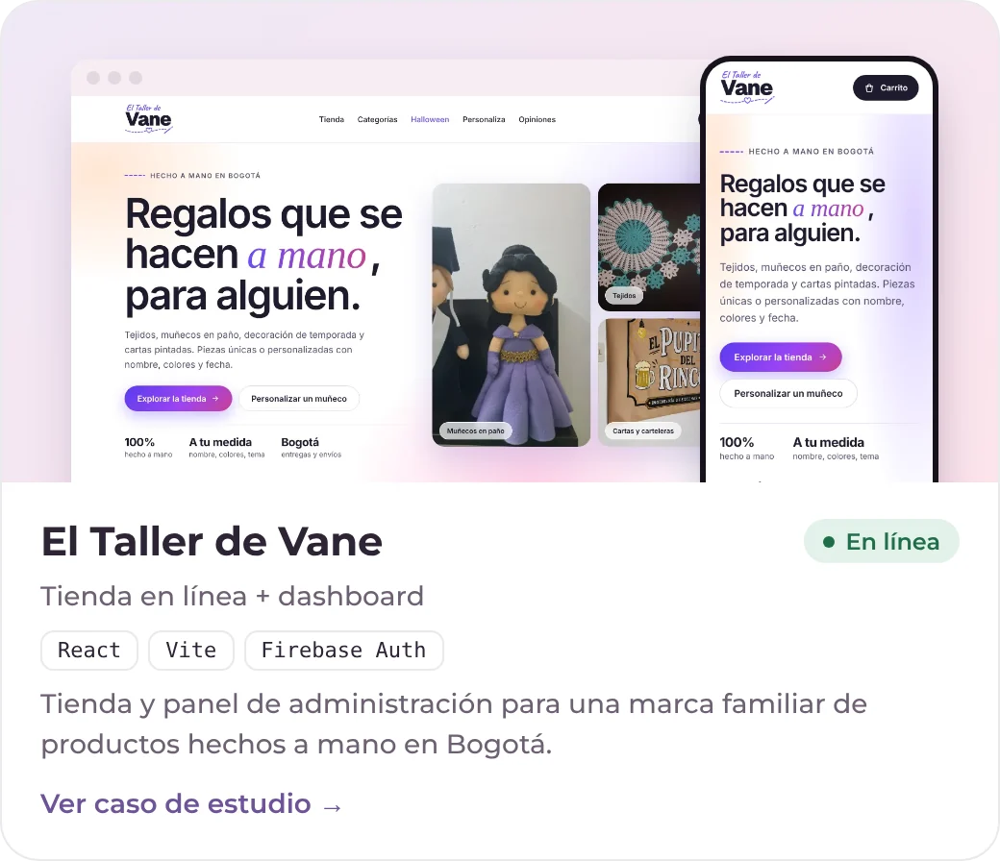</picture></a>
  <a href="https://aliz-mejia.vercel.app/#/proyecto/exe-presentaciones"><picture><source media="(prefers-color-scheme: dark)" srcset="assets/proyecto-exe-presentaciones-oscuro.webp">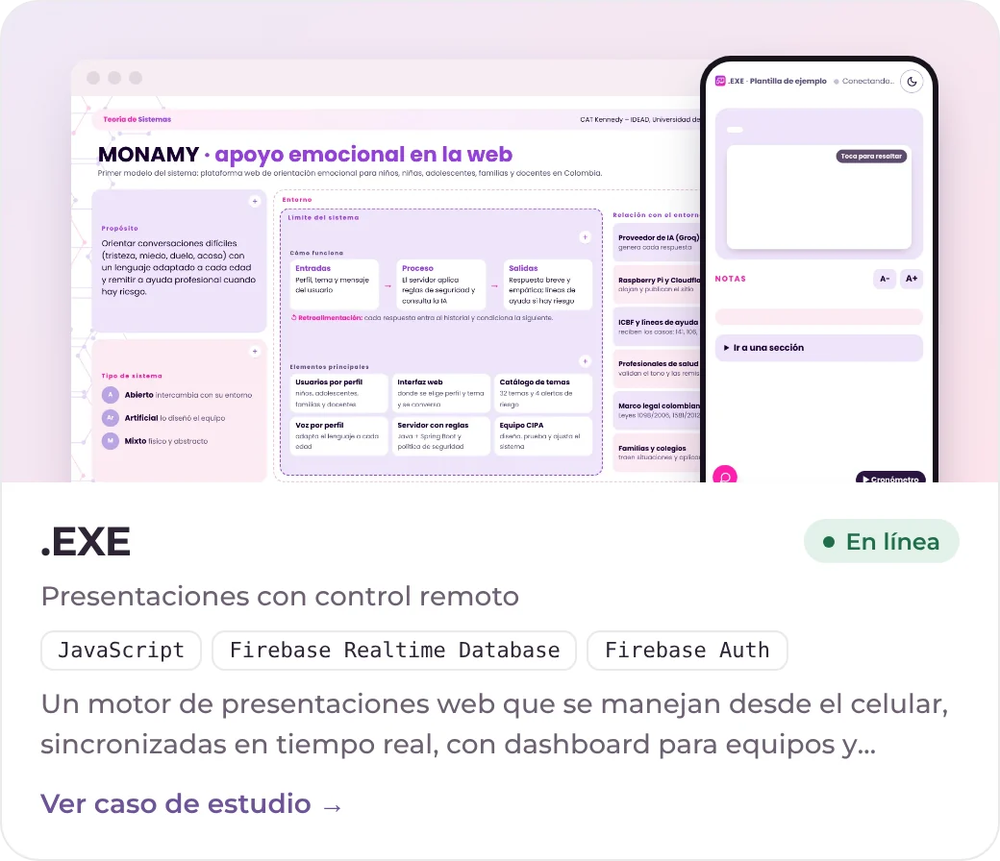</picture></a>

  <a href="https://aliz-mejia.vercel.app/#/proyecto/emily-pizza"><picture><source media="(prefers-color-scheme: dark)" srcset="assets/proyecto-emily-pizza-oscuro.webp">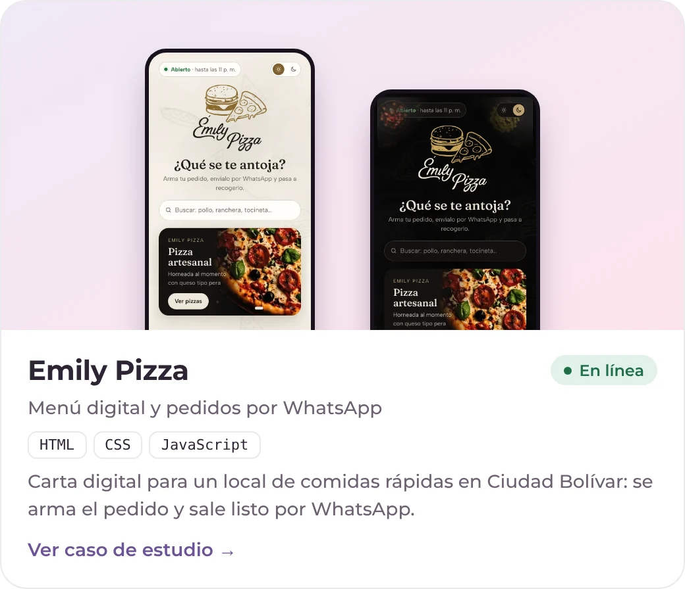</picture></a>
  <a href="https://aliz-mejia.vercel.app/#/proyecto/cuidapp"><picture><source media="(prefers-color-scheme: dark)" srcset="assets/proyecto-cuidapp-oscuro.webp">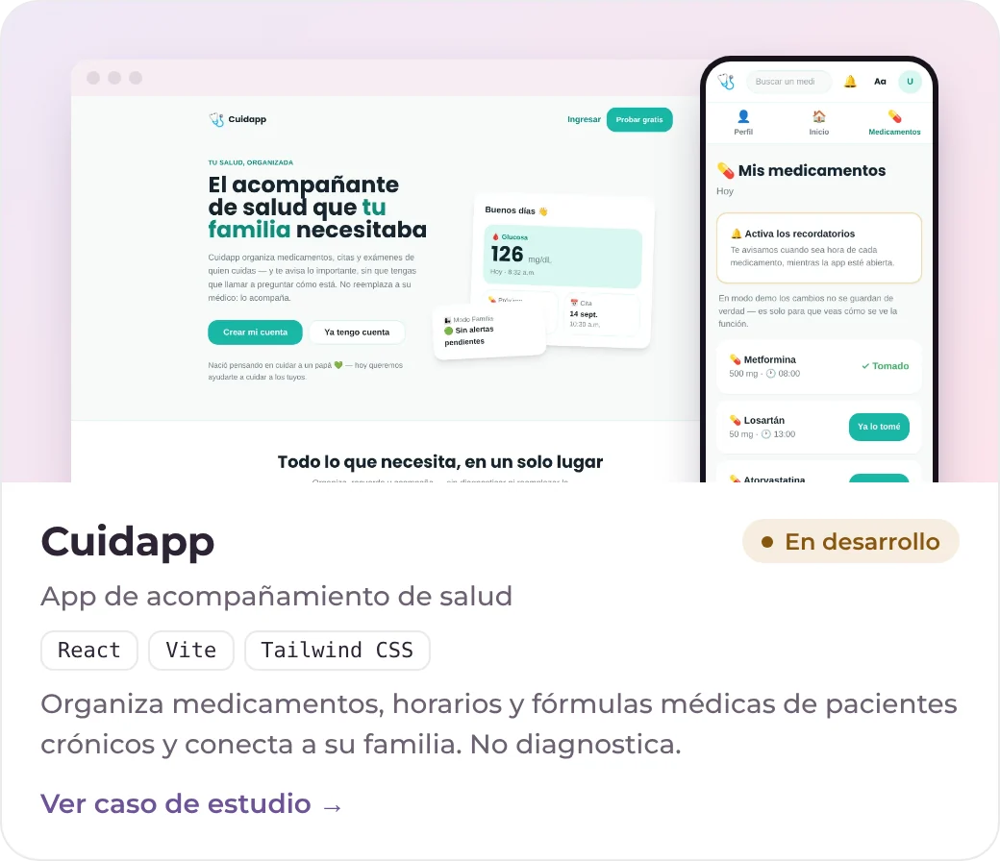</picture></a>

<b>Ver más proyectos</b>

 

  <a href="https://aliz-mejia.vercel.app/#/proyecto/maletica"><picture><source media="(prefers-color-scheme: dark)" srcset="assets/proyecto-maletica-oscuro.webp">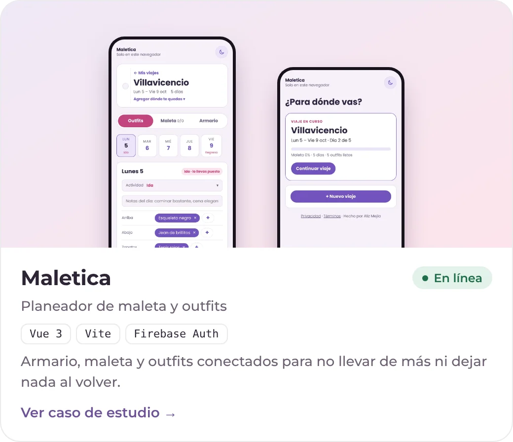</picture></a>

| Proyecto | Qué es | Con qué |
|---|---|---|
| [Módulos para Odoo 16](https://aliz-mejia.vercel.app/#/proyecto/odoo-andrec) | Reglas de negocio dentro del ERP de Andrec | Python · ORM de Odoo |
| [Colaxis](https://aliz-mejia.vercel.app/#/proyecto/colaxis) | Sitio corporativo para cliente B2B (Colombia y Ecuador) | HTML · CSS · JavaScript |
| [MotoCoach](https://aliz-mejia.vercel.app/#/proyecto/motocoach) | Finanzas para repartidores en moto | React · Firebase |
| [TearSpa](https://aliz-mejia.vercel.app/#/proyecto/tearspa) | Tienda con panel de productos, usuarios y ventas | PHP · MySQL |

<a href="https://aliz-mejia.vercel.app/#/proyectos"><b>Todos los proyectos, con filtros →</b></a>

  <a href="https://aliz-mejia.vercel.app/#lab"><b>✦ Probar las demos interactivas en mi portafolio →</b></a>

 

## ✦ Tecnologías que uso

  <picture>
    <source media="(prefers-color-scheme: dark)" srcset="assets/stack-oscuro.svg">
    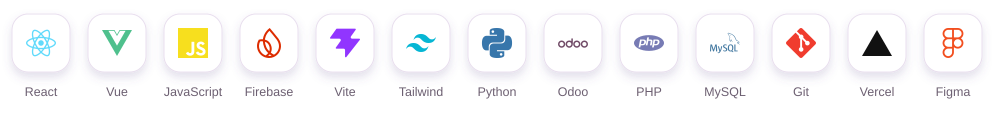
  </picture>

<b>¿Dónde uso cada una?</b>

 

| Tecnología | Dónde la usé |
|---|---|
| **Vue 3** | MuMu · Maletica |
| **React** | El Taller de Vane · Cuidapp · MotoCoach |
| **Firebase** (Auth, Firestore, Storage, Realtime DB) | MuMu · El Taller de Vane · .EXE · Emily Pizza · Cuidapp · Maletica |
| **APIs de Google** (Gmail, Calendar, Classroom) y **Moodle** | MuMu |
| **Funciones serverless** (Vercel) | MuMu |
| **Python** · **Odoo 16** | Módulos para Andrec |
| **PHP** · **MySQL** | TearSpa · Laser Center |
| **Tailwind CSS** | Cuidapp |
| **PWA** (instalable, service worker) | MuMu · .EXE · Emily Pizza |
| **OCR** (Tesseract.js) | Cuidapp |
| **Figma** | Diseño de interfaces y marca |

 

## ✦ Mi actividad

  <picture>
    <source media="(prefers-color-scheme: dark)" srcset="https://raw.githubusercontent.com/alizz3/alizz3/output/stats-oscuro.svg">
    
  </picture>

  <picture>
    <source media="(prefers-color-scheme: dark)" srcset="https://raw.githubusercontent.com/alizz3/alizz3/output/snake-oscuro.svg">
    
  </picture>

 

  <i>"El mejor modo de predecir el futuro es inventándolo."</i> — Alan Kay

  ¿Te sirvió algo de lo que hago? <a href="https://buymeacoffee.com/alizz">Invítame un café</a> y me ayudas a seguir construyendo.

