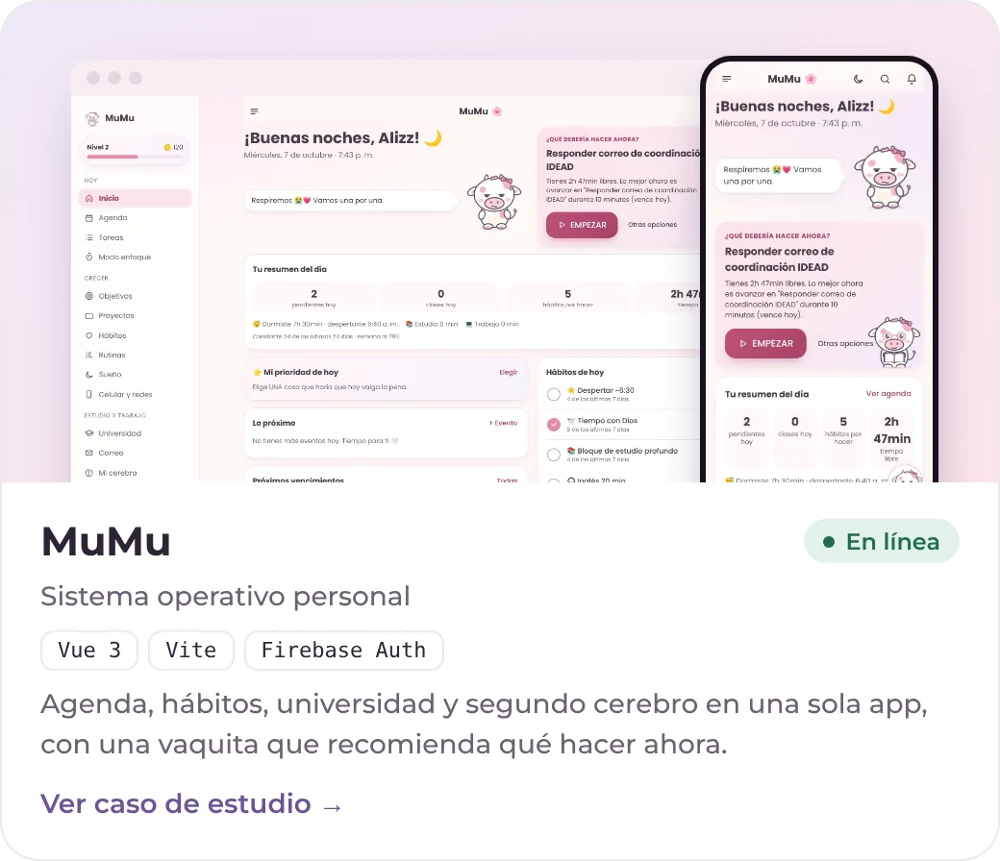

<a href="https://aliz-mejia.vercel.app">
  <picture>
    <source media="(prefers-color-scheme: dark)" srcset="assets/banner-oscuro.svg">
    
  </picture>
</a>

  <a href="https://aliz-mejia.vercel.app"><picture><source media="(prefers-color-scheme: dark)" srcset="assets/btn-portafolio-oscuro.webp"></picture></a>
  <a href="https://www.linkedin.com/in/alizz-doblezz"><picture><source media="(prefers-color-scheme: dark)" srcset="assets/btn-linkedin-oscuro.webp"></picture></a>
  <a href="mailto:dev.doblezz@gmail.com"><picture><source media="(prefers-color-scheme: dark)" srcset="assets/btn-correo-oscuro.webp"></picture></a>
  <a href="https://wa.me/573113071168"><picture><source media="(prefers-color-scheme: dark)" srcset="assets/btn-whatsapp-oscuro.webp"></picture></a>

 

## ✦ Hola, soy Aliz

Desarrolladora de software en Villavicencio, Colombia. Construyo aplicaciones web de punta a punta: **tiendas, dashboards e integraciones con APIs** que hoy usan personas reales. Me importa tanto la base de datos como el logo, y antes de escribir código pregunto quién lo va a usar y desde qué celular.

- 💼 Trabajé 2 años y medio en **Andrec Corporation** (Odoo 16, desarrollo web y diseño). Hoy hago proyectos **freelance**.
- 🎓 Estudio **Ingeniería de Sistemas** en la Universidad del Tolima. Soy **técnica en Programación de Software** del SENA.
- 🔎 Busco un puesto de desarrollo **remoto** y proyectos de tiendas, dashboards y herramientas internas.
- 🐮 Dato curioso: amo las vacas. Por eso MuMu tiene una vaquita que te dice qué hacer.

<b>🇬🇧 English</b>

 

Software developer based in Villavicencio, Colombia. I build web apps end to end: **online stores, dashboards and API integrations** that real people use today. I care about the database as much as the logo, and before writing code I ask who will use it and on what phone.

- 💼 Two and a half years at **Andrec Corporation** (Odoo 16, web development and design). Now working **freelance**.
- 🎓 Studying **Systems Engineering** at Universidad del Tolima. **Software Programming Technician** (SENA).
- 🔎 Open to **remote** developer roles and freelance projects: stores, dashboards and internal tools.
- 🐮 Fun fact: I love cows. That's why MuMu has a little cow that tells you what to do next.

 

## ✦ Proyectos destacados

  <a href="https://aliz-mejia.vercel.app/#/proyecto/mumu"><picture><source media="(prefers-color-scheme: dark)" srcset="assets/proyecto-mumu-oscuro.webp"></picture></a>
  <a href="https://aliz-mejia.vercel.app/#/proyecto/el-taller-de-vane"><picture><source media="(prefers-color-scheme: dark)" srcset="assets/proyecto-el-taller-de-vane-oscuro.webp"></picture></a>

  <a href="https://aliz-mejia.vercel.app/#/proyecto/exe-presentaciones"><picture><source media="(prefers-color-scheme: dark)" srcset="assets/proyecto-exe-presentaciones-oscuro.webp"></picture></a>
  <a href="https://aliz-mejia.vercel.app/#/proyecto/emily-pizza"><picture><source media="(prefers-color-scheme: dark)" srcset="assets/proyecto-emily-pizza-oscuro.webp"></picture></a>

  <a href="https://aliz-mejia.vercel.app/#/proyecto/cuidapp"><picture><source media="(prefers-color-scheme: dark)" srcset="assets/proyecto-cuidapp-oscuro.webp"></picture></a>
  <a href="https://aliz-mejia.vercel.app/#/proyecto/maletica"><picture><source media="(prefers-color-scheme: dark)" srcset="assets/proyecto-maletica-oscuro.webp"></picture></a>

  <a href="https://aliz-mejia.vercel.app/#/proyectos"><b>Ver todos mis proyectos →</b></a>
  &nbsp;·&nbsp;
  <a href="https://aliz-mejia.vercel.app/#lab"><b>Probar las demos interactivas →</b></a>

 

## ✦ Tecnologías que uso

  <picture>
    <source media="(prefers-color-scheme: dark)" srcset="assets/stack-oscuro.webp">
    
  </picture>

 

  <i>"El mejor modo de predecir el futuro es inventándolo."</i> — Alan Kay

